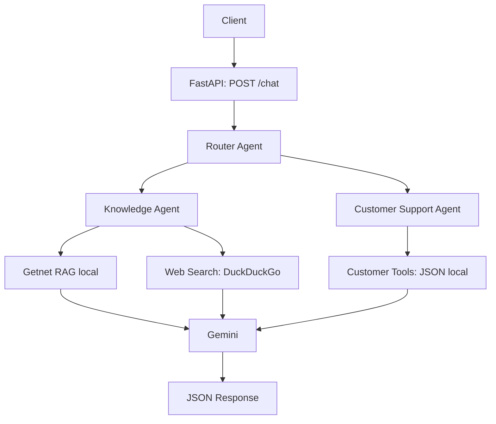

# AI Hardcore Engineer - Multi-Agent Support System

API síncrona de suporte com Python 3.12, FastAPI e **exatamente três agentes**, conectados por chamadas diretas de funções. Gemini é o único LLM. Documentos e clientes ficam em JSON local; o retrieval usa TF-IDF e similaridade de cosseno.

## Arquitetura e fluxo



1. FastAPI valida `message` e `user_id` com Pydantic.
2. O Router pede ao Gemini um JSON com `route`, usando `response_mime_type` e um schema com os três valores permitidos.
3. O JSON é validado novamente antes do encaminhamento. Uma classificação inválida produz HTTP 502; não existe fallback que escolha uma rota silenciosamente.
4. O agente selecionado recupera seu contexto, chama Gemini e retorna `answer`, `agents_used`, `tools_used` e `sources`.

| Rota | Responsabilidade | Agente / tool |
| --- | --- | --- |
| `knowledge_getnet` | Produtos, Pix, crediário, antecipação, Link de Pagamento, máquinas e regras públicas | Knowledge / `getnet_rag` |
| `knowledge_web` | Clima, cotações, notícias e informações externas gerais | Knowledge / `web_search` |
| `customer_support` | Vendas e depósitos do cliente, sua configuração, máquina com falha e erros operacionais | Customer Support / customer tools |

O prompt diferencia dúvidas gerais de problemas concretos: requisitos bancários para receber por Pix são conhecimento público; o depósito das vendas de ontem exige dados do cliente. A mensagem do usuário é serializada como dado, e o modelo recebe instruções para não obedecer a comandos embutidos na mensagem ou nos documentos.

### Knowledge: Getnet RAG

A ingestão é explícita e independente da inicialização da API:

```text
URLs Getnet → httpx → HTML → BeautifulSoup → texto → chunks com source
           → data/rag/chunks.json → TF-IDF → cosine similarity → top-4 → Gemini
```

- Fontes iniciais: `https://www.getnet.net/` e `https://www.getnet.net/en`.
- Crawling sequencial de até **6 URLs tentadas** por padrão, configurável de 2 a 10. Links descobertos ficam no mesmo domínio, em HTTPS, sem query string ou fragmento. Redirecionamentos para outro domínio não são incorporados à base.
- BeautifulSoup remove scripts, estilos e elementos de navegação e prioriza o conteúdo de `main` ou `article`.
- Chunks de 180 palavras, com sobreposição de 30, preservam `text` e `source`. URLs iniciais que redirecionam para a mesma página não duplicam seus chunks.
- O JSON é salvo por substituição atômica. Falhas parciais são relatadas; se todas as páginas falharem, a base anterior é preservada e o comando termina com código 1.
- `TfidfVectorizer`, com unigramas, bigramas e normalização de acentos, cria a matriz local. A consulta usa similaridade de cosseno e devolve até quatro chunks com pontuação maior que zero.
- A matriz é reconstruída do pequeno JSON em cada consulta. Não há banco vetorial, embeddings ou arquivos pickle.
- O prompt exige resposta no idioma da pergunta, somente com suporte no contexto, preservando URLs e admitindo falta de informações. Ausência de termos relevantes gera contexto vazio; não são introduzidos documentos fictícios na base pública.

Depois da ingestão, **extração e retrieval funcionam sem acesso às páginas Getnet**. A geração ainda precisa acessar Gemini. Uma base ausente, vazia ou inválida produz HTTP 503 somente nas consultas Getnet; `/health`, busca web e suporte continuam independentes da base RAG.

### Knowledge: busca web

`web_search(query)` usa `DDGS.text` com `backend="duckduckgo"`, sem chave de busca, e retorna até cinco resultados validados com `title`, `snippet` e `url`. Títulos/snippets e URLs são enviados ao Gemini. Não são baixadas as páginas dos resultados. O prompt proíbe completar lacunas com informações inventadas e pede atenção às datas de notícias, clima e cotações. Uma busca sem resultados pode gerar uma resposta explicando a insuficiência de informações; falhas do provedor geram HTTP 502.

`sources` lista as URLs do contexto fornecido à geração, sem duplicatas. Sua presença não garante que todos os detalhes solicitados estejam disponíveis nos trechos.

### Customer Support e tools

Um segundo JSON estruturado do Gemini escolhe uma ou ambas as tools permitidas. A seleção é validada e executada por uma lista explícita de funções; o modelo não escolhe outro `user_id` nem executa funções arbitrárias.

- `get_customer_profile(user_id)`: cadastro e configuração de recebimento.
- `get_customer_activity(user_id)`: vendas, depósitos previstos, máquina, conectividade e último erro de transação.

`data/customers.json` contém `cliente1988`, com registros **inteiramente fictícios** e um snapshot fixo em **15/10/2026**. Há uma venda de débito e uma de crédito em 14/10, com previsões distintas. O agente recebe datas explícitas, deve identificar a demonstração e não pode prometer uma transferência real. Em outra data, “ontem” não atualiza esses registros automaticamente. Cliente inexistente gera HTTP 404 com informação clara; base local inválida gera HTTP 503.

## Estrutura

```text
app/
  main.py                  # FastAPI, composição e tratamento de erros
  config.py                # .env e variáveis de ambiente
  schemas.py               # requests, respostas, decisões e erros controlados
  agents/
    router.py
    knowledge.py
    customer_support.py
  services/gemini.py        # único ponto de acesso ao LLM
  rag/
    ingest.py              # CLI de coleta, extração e chunking
    retriever.py           # TF-IDF e cosine similarity
  tools/
    web_search.py
    customer_data.py
data/
  customers.json
  rag/                     # chunks.json gerado e ignorado pelo Git
tests/
  conftest.py
  test_router.py
  test_rag.py
  test_customer_tools.py
  test_api.py
  test_services.py
.env.example
requirements.txt
Dockerfile
docker-compose.yml
```

## Configuração do Gemini

```bash
cp .env.example .env
```

Edite `.env` e preencha sua chave. O arquivo é ignorado pelo Git e pelo contexto do Docker. Variáveis já exportadas prevalecem sobre o `.env` na execução local.

```dotenv
GEMINI_API_KEY=sua-chave
GEMINI_MODEL=gemini-flash-latest
GEMINI_TIMEOUT_SECONDS=30
HTTP_TIMEOUT_SECONDS=15
```

O nome do modelo é configurável; use um modelo Gemini disponível na sua conta. Para operar sem custos, utilize uma conta/modelo com cota gratuita e sem cobrança habilitada. A aplicação não contrata recursos ou serviços adicionais. Limites e disponibilidade da API dependem da conta Google.

Todas as chamadas usam `google-genai` em `app/services/gemini.py`, com timeout em milissegundos no SDK e uma tentativa por chamada. Não há mecanismo próprio de retry. O cliente é fechado após cada geração. Sem chave, `/health` funciona e `/chat` retorna 503. Não há chamadas ao Gemini durante a inicialização ou ingestão.

Referências das interfaces: [Google Gen AI SDK](https://googleapis.github.io/python-genai/) e [DDGS](https://pypi.org/project/ddgs/).

## Execução local

Requer Python **3.12** e acesso à internet para instalar dependências, coletar documentos e acessar Gemini/busca web.

```bash
python3.12 -m venv .venv
source .venv/bin/activate
pip install -r requirements.txt
cp .env.example .env
# Preencha GEMINI_API_KEY em .env.
python -m app.rag.ingest
uvicorn app.main:app --host 0.0.0.0 --port 8000
```

Para tentar apenas as duas páginas iniciais:

```bash
python -m app.rag.ingest --max-pages 2
```

O resultado da ingestão informa `pages_loaded`, `chunks` e `failures`. Reexecute o comando para atualizar a base. A API lê a base atualizada na consulta seguinte. O diretório pode ser alterado com `DATA_DIR`, contendo tanto `customers.json` quanto `rag/chunks.json`.

## Execução com Docker

Requer Docker e Docker Compose com suporte a `env_file.required` (Compose 2.24 ou superior).

```bash
cp .env.example .env
# Preencha GEMINI_API_KEY em .env.
docker compose up --build
```

API: `http://localhost:8000`. Documentação interativa: `http://localhost:8000/docs`.

Em outro terminal, carregue a base Getnet antes da primeira consulta RAG:

```bash
docker compose exec api python -m app.rag.ingest
```

Existe somente um serviço/container. `./data` é montado em `/app/data`, preservando os documentos após recriação do container. A API inicia mesmo sem `.env` ou sem corpus para permitir verificar `/health`; consultas dependentes de configuração ausente retornam erro explícito.

```bash
docker compose down
```

## API e exemplos

```bash
curl -s http://localhost:8000/health
```

```json
{"status":"ok"}
```

Getnet RAG:

```bash
curl -s http://localhost:8000/chat \
  -H 'Content-Type: application/json' \
  -d '{"message":"How does receivables advance (antecipação) work with Getnet?","user_id":"cliente1988"}'
```

Busca web:

```bash
curl -s http://localhost:8000/chat \
  -H 'Content-Type: application/json' \
  -d '{"message":"What is the weather forecast in Porto Alegre tomorrow?","user_id":"cliente1988"}'
```

Atendimento:

```bash
curl -s http://localhost:8000/chat \
  -H 'Content-Type: application/json' \
  -d '{"message":"When will the money from yesterday’s sales be deposited?","user_id":"cliente1988"}'
```

Formato de resposta de atendimento (texto ilustrativo, a redação depende do modelo):

```json
{
  "answer": "In these fictional records, the debit sale from October 14 is scheduled for October 15, 2026; the credit sale is scheduled for November 13, 2026.",
  "agents_used": ["router", "customer_support"],
  "tools_used": ["get_customer_activity"],
  "sources": []
}
```

Knowledge retorna `agents_used: ["router", "knowledge"]` com `getnet_rag` ou `web_search` em `tools_used`, além das URLs recuperadas em `sources`.

| HTTP | Situação |
| --- | --- |
| 200 | Resposta gerada, inclusive quando o contexto é insuficiente e isso é informado |
| 404 | Cliente sem dados locais |
| 422 | Campos ausentes, vazios, extras ou fora dos limites |
| 502 | Falha do Gemini/busca, resposta vazia ou JSON de decisão inválido |
| 503 | Chave não configurada ou base local necessária indisponível |
| 504 | Timeout do Gemini |

Erros controlados usam `{"detail":"descrição"}`. Erros de validação usam o formato padrão de detalhes do FastAPI. `/health` confirma que o processo está respondendo; não verifica disponibilidade dos provedores externos.

## Testes e critérios de aceitação

```bash
source .venv/bin/activate
python -m pytest -q
```

No container:

```bash
docker compose exec api python -m pytest -q
```

Os testes não precisam de chave nem consomem Gemini. Gemini e DuckDuckGo são substituídos por mocks; a ingestão usa `httpx.MockTransport` e o RAG usa pequenos documentos temporários. Há bloqueio padrão de instâncias reais do SDK e de DDGS nos testes.

A suíte verifica decisões válidas e inválidas, composição dos agentes, contexto enviado ao modelo, perfil/atividade, cliente inexistente, extração/chunking, ranking TF-IDF, limites de crawling, falhas parciais/totais, preservação da base anterior, schemas HTTP, timeouts e falhas de serviços.

Os dez casos do enunciado exercitam `/chat` com os agentes reais e decisões do Gemini simuladas:

| Caso | Pergunta | Rota esperada |
| --- | --- | --- |
| 1 | Get Clássica versus Get Smart | `knowledge_getnet` |
| 2 | Previsão do tempo em Porto Alegre amanhã | `knowledge_web` |
| 3 | Depósito das vendas de ontem | `customer_support` |
| 4 | Necessidade de conta bancária para receber via Pix | `knowledge_getnet` |
| 5 | Minha máquina não conecta à internet | `customer_support` |
| 6 | Como funciona antecipação Getnet | `knowledge_getnet` |
| 7 | Cotação do euro hoje | `knowledge_web` |
| 8 | Minha máquina mostra erro de transação recusada | `customer_support` |
| 9 | Parcelas no crediário | `knowledge_getnet` |
| 10 | Vender por WhatsApp com Link de Pagamento | `knowledge_getnet` |

Esses testes validam o encaminhamento e o tratamento das decisões; não medem a precisão de classificação do modelo real. As perguntas também constam no prompt do Router. A qualidade factual e a classificação com o Gemini escolhido precisam ser avaliadas com uma chave configurada e fontes atuais.

## Limitações

- Projeto de demonstração local, sem autenticação ou integração com contas reais. Os dados e condições financeiras dos clientes são fictícios e não representam ofertas Getnet.
- A coleta é limitada a HTML público e não executa JavaScript. Bloqueios, mudanças no site ou cobertura insuficiente podem impedir respostas sobre produtos específicos. O agente deve informar essa insuficiência.
- TF-IDF mede coincidência de termos; não oferece compreensão semântica nem tradução entre idiomas. As duas fontes iniciais ajudam na cobertura, mas perguntas sem vocabulário compartilhado podem não encontrar contexto.
- Snippets de busca podem estar incompletos ou desatualizados e não são uma fonte garantida de previsões ou cotações em tempo real. DuckDuckGo pode limitar ou bloquear solicitações.
- Os prompts restringem invenções, mas não oferecem garantia matemática contra alucinações ou injeção de instruções. As fontes retornadas permitem revisão.
- Fluxo síncrono, voltado a pequeno volume: duas chamadas Gemini para conhecimento, três para suporte. Não há histórico de conversas, agendamento ou atualização automática do corpus.
